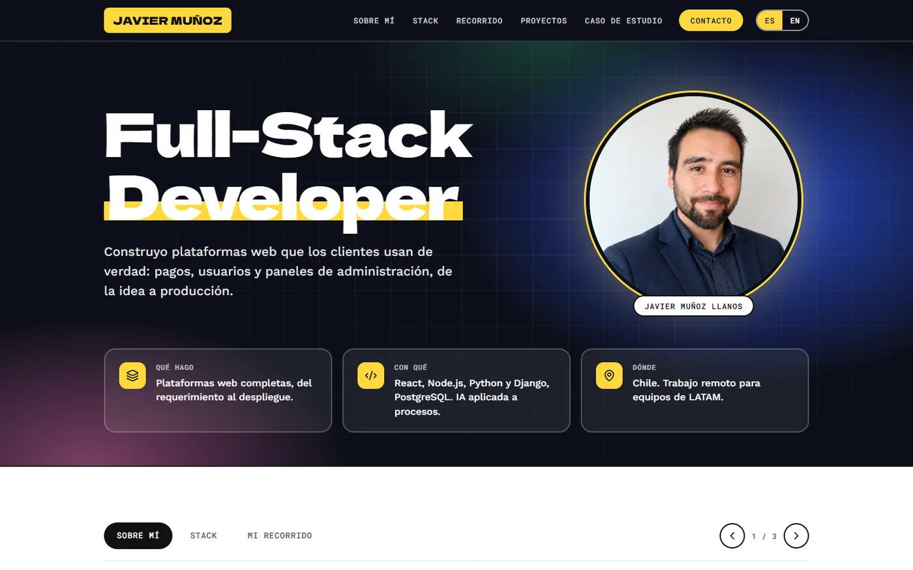
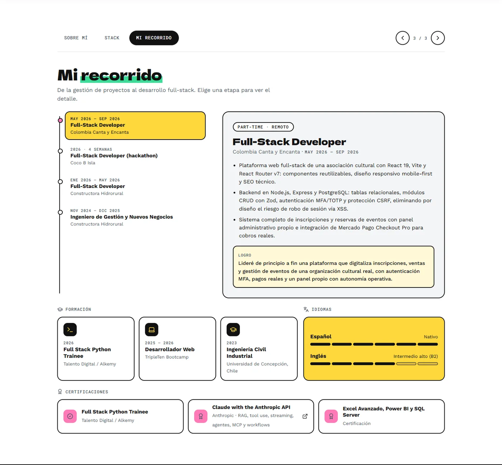
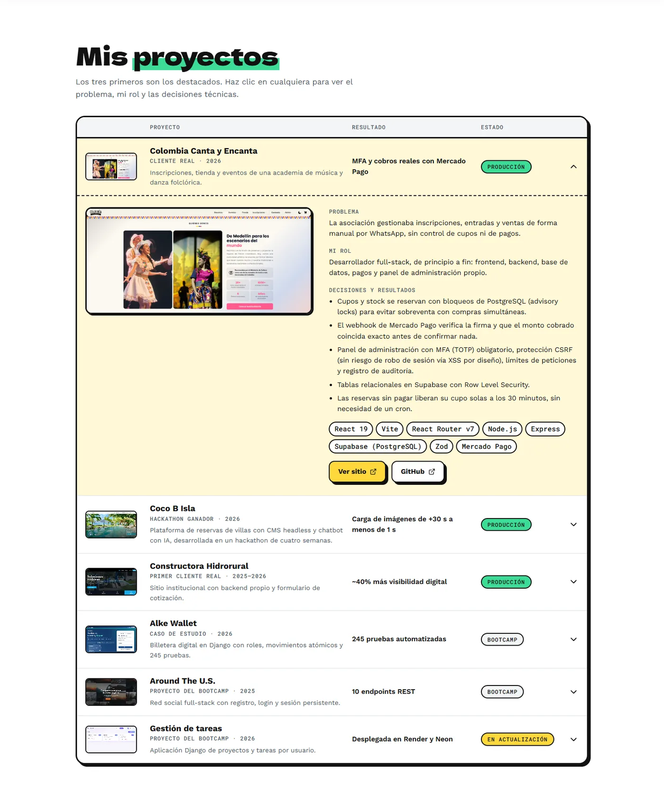
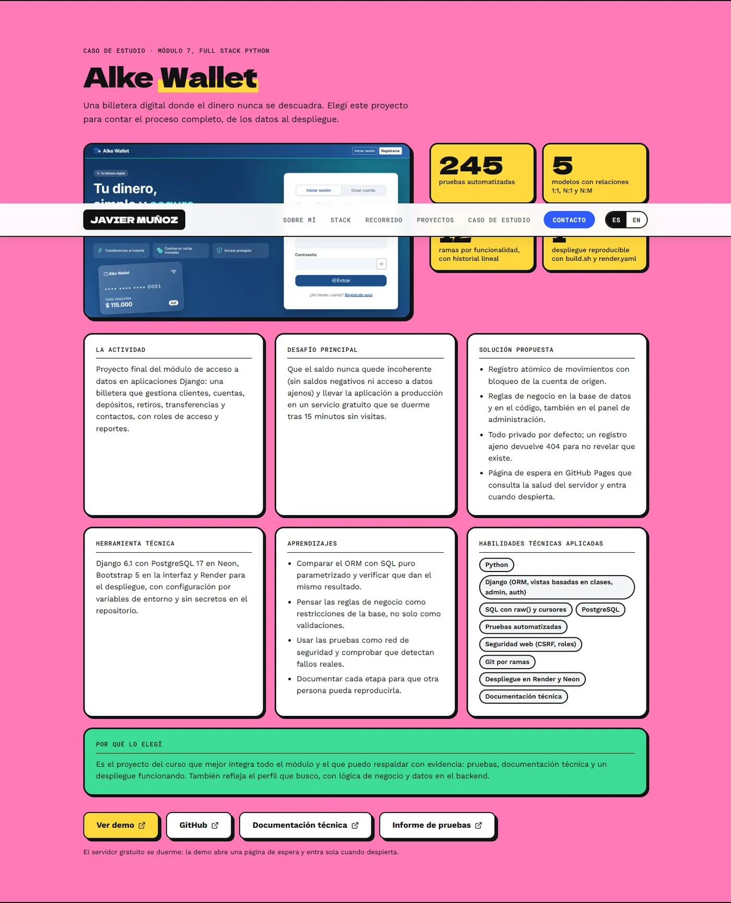
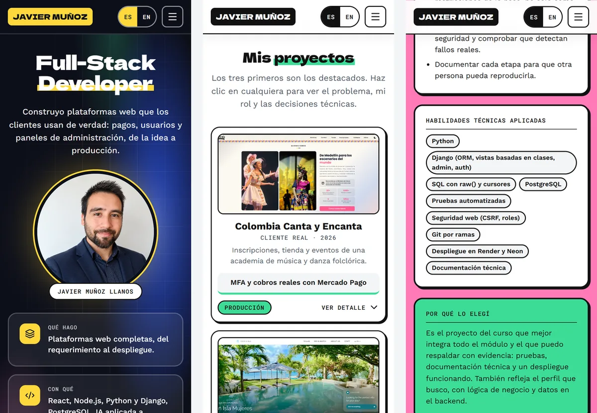

# Portafolio · Javier Muñoz Llanos

Portafolio profesional de **Javier Muñoz Llanos**, Full-Stack Developer (React, Node.js, Python/Django, PostgreSQL) con base en Chile y disponible para trabajo remoto en LATAM.

**Ver en vivo: [javiermll.github.io/Portafolio](https://javiermll.github.io/Portafolio/)** · [Ir directo al caso de estudio](https://javiermll.github.io/Portafolio/#case-study)



> **English summary:** personal portfolio built with React 19 and Vite, bilingual (ES/EN), responsive and accessible. It presents six projects (three real-client or hackathon products), a full case study of a Django wallet app, and a working contact form. Deployed on GitHub Pages.

## Qué es y para quién

Es la carta de presentación técnica de Javier para reclutadores y clientes. Está pensada para responder rápido tres preguntas: **qué hace, con qué tecnologías y qué resultados ha logrado**. Cada proyecto cuenta el problema, el rol y las decisiones técnicas, y uno de ellos (Alke Wallet) se desarrolla como caso de estudio completo.

También es el entregable del módulo *Desarrollo de portafolio de un producto digital* (Full Stack Python Trainee, Talento Digital / Alkemy).

## Qué incluye

- **Portada y perfil:** presentación, foto y tres ejes (qué hace, con qué, dónde).
- **Carrusel de perfil:** Sobre mí, Stack y Mi recorrido (línea de tiempo interactiva con logros, formación, idiomas y certificaciones).
- **Proyectos:** tabla con resultado y estado; cada fila despliega el problema, el rol, las decisiones técnicas, las tecnologías y los enlaces (demo y código).
- **Caso de estudio:** *Alke Wallet* con descripción, desafío, solución, herramienta, aprendizajes, métricas de impacto, habilidades y justificación.
- **Contacto:** formulario funcional que llega al correo de Javier, con validación y protección anti-spam.
- **Español e inglés:** selector ES | EN en la barra superior, con la elección guardada en el navegador.

| Recorrido | Proyectos |
|---|---|
|  |  |

| Caso de estudio | Móvil |
|---|---|
|  |  |

## Tecnologías

| Área | Herramientas |
|---|---|
| Interfaz | React 19, JavaScript (ES2022+), CSS por componente (sin frameworks de UI) |
| Build | Vite 8 |
| Animación y scroll | framer-motion, Lenis |
| Íconos | lucide-react |
| Idiomas | Diccionarios propios (`src/i18n`), sin librería externa |
| Formulario | [Web3Forms](https://web3forms.com) (reenvía cada mensaje al correo) |
| Calidad | ESLint |
| Despliegue | GitHub Pages con `gh-pages` |

## Cómo ejecutarlo en local

Requiere Node.js 20.19 o superior (probado con Node 24).

```bash
git clone https://github.com/Javiermll/Portafolio.git
cd Portafolio
npm install
cp .env.example .env     # opcional: pega tu clave de Web3Forms
npm run dev              # http://localhost:5173/Portafolio/
```

| Comando | Qué hace |
|---|---|
| `npm run dev` | Servidor de desarrollo con recarga en vivo |
| `npm run build` | Compila a `dist/` |
| `npm run preview` | Sirve la versión compilada |
| `npm run lint` | Revisa el código con ESLint |
| `npm run deploy` | Compila y publica `dist/` en la rama `gh-pages` |

**Formulario de contacto.** Necesita una clave gratuita de Web3Forms en la variable `VITE_WEB3FORMS_KEY` del archivo `.env` (ver `.env.example`). La clave es pública por diseño y se incluye al compilar. Sin ella, el formulario muestra el correo de contacto como alternativa.

## Estructura

```text
src/
├── components/        # Un componente por sección, cada uno con su .jsx y su .css
│   ├── Navbar/        # Barra superior, idioma y menú móvil
│   ├── Hero/          # Portada
│   ├── Profile/       # Carrusel: Sobre mí, Stack y Recorrido (usa About, Stack, Experience)
│   ├── Projects/      # Tabla de proyectos con detalle desplegable
│   ├── CaseStudy/     # Caso de estudio de Alke Wallet
│   └── Contact/       # Pie de página y formulario de contacto
├── data/              # Datos estructurales: proyectos y stack
├── i18n/              # Textos en español (es.js) e inglés (en.js) y su proveedor
├── index.css          # Variables de diseño y estilos globales
└── App.jsx            # Composición de las secciones y desplazamiento suave
public/assets/         # Imágenes optimizadas (WebP)
capturas/              # Capturas usadas en este README
```

## Cómo editar el contenido

- **Textos (español e inglés):** `src/i18n/es.js` y `src/i18n/en.js`. Los dos archivos tienen la misma forma.
- **Proyectos:** datos comunes (enlaces, tecnologías, imagen, estado) en `src/data/projects.js`; los textos de cada proyecto, en los diccionarios de idioma bajo `projects.items`.
- **Stack:** `src/data/stack.js`.
- **Colores y tipografías:** variables al inicio de `src/index.css`.
- **Imágenes:** convertidas a WebP y guardadas en `public/assets/`; se referencian siempre con `import.meta.env.BASE_URL`.

## Calidad

Revisado con navegador real y herramientas automáticas (los scripts de prueba no forman parte de este repositorio):

- **Accesibilidad:** axe-core (WCAG 2.2 AA) sin violaciones en 18 estados (ES/EN, escritorio y móvil, cada diapositiva, proyecto abierto y formulario con errores). Navegación completa por teclado con enlace «Saltar al contenido», foco visible y soporte de «reducir movimiento».
- **Responsive:** sin desbordes horizontales en 320, 360, 390, 430, 768, 820, 1024, 1280 y 1440 px.
- **Formulario:** 22 pruebas de validación, errores de red, espera entre envíos y anti-spam.
- **Peso:** JavaScript 395 KB (125 KB comprimido), CSS 28 KB (6 KB comprimido) e imágenes en WebP (`public/` pesa menos de 1 MB).

## Mantenimiento

El portafolio se actualiza cada vez que termino un proyecto o aprendo algo nuevo. El proyecto *Gestión de tareas* aparece marcado como «en actualización» hasta que su rediseño esté listo.

## Contacto

- LinkedIn: [javiermunoz-fullstackdeveloper](https://www.linkedin.com/in/javiermunoz-fullstackdeveloper/)
- GitHub: [Javiermll](https://github.com/Javiermll)
- Correo: Javier.munozll96@gmail.com
